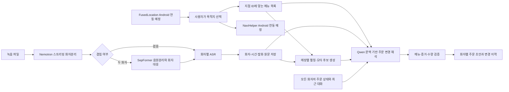

# 모아오더(MoaOrder)

**함께 가는 길, 주문은 하나로.**

목적지로 이동하며 나눈 대화에서 누가 무엇을 주문할지 정리하는 음성 기반 주문 도우미입니다.
선택한 매장의 메뉴를 참고해 화자별 발화를 기록하고, 메뉴 추가·변경·취소를 반영하여 주문서를 작성합니다.
목적지를 선택하고 직접 녹음하거나 음성 파일을 올려, 화자별 주문 결과를 확인할 수 있습니다.

## 웹 프로토타입

### [모아오더 웹으로 체험해보기](https://udder-purify-retract.ngrok-free.dev/)

[웹 사용 안내](demo/README.md)

---

## 시연 영상

### [모아오더 시연 영상 보러가기](https://youtu.be/Sa-5V4HNdrk)

---

## 실행 Pipeline
FusedLocation과 NaviHelper의 Android 연동은 추후 진행 예정.

## 개발자 안내

[로컬 실행과 모델 준비](docs/SETUP.md)에서 환경을 구성한 뒤 실행할 수 있습니다. 모델 가중치와 녹음 결과는 저장소에 포함되지 않습니다.

| 경로 | 내용 |
|---|---|
| [drive_order/](drive_order/) | 음성 처리와 주문 정리 파이프라인 |
| [demo/](demo/) | 웹 화면, 서버 운영 안내, 매장 메뉴 |
| [examples/](examples/) | 메뉴·목적지·대화 입력 예시 |
| [scripts/](scripts/) · [tests/](tests/) | 모델 준비, 평가, 기능 검증 |
| [VALIDATION.md](VALIDATION.md) | 기준 구현의 검증 기록과 한계 |
| [ios/](ios/) · [android-contract/](android-contract/) | 앱 소스와 차량 SDK 연동 설계 |

실행 성공과 주문 정확도는 구분해 확인합니다. 실제 차량 소음, 장시간 자연 대화, 세 명 이상 동시 발화에 대한 검증은 추가로 필요합니다.
