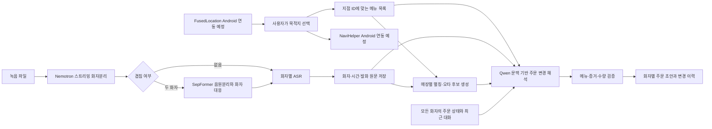

# 모아오더(MoaOrder)

**함께 가는 길, 주문은 하나로.**

목적지로 이동하며 나눈 대화에서 누가 무엇을 주문할지 정리하는 음성 기반 주문 도우미입니다.
선택한 매장의 메뉴를 참고해 화자별 발화를 기록하고, 메뉴 추가·변경·취소를 반영하여 주문서를 작성합니다.
목적지를 선택하고 직접 녹음하거나 음성 파일을 올려, 화자별 주문 결과를 확인할 수 있습니다.

## 웹 프로토타입

### [모아오더 웹으로 체험해보기](https://udder-purify-retract.ngrok-free.dev/)

서버가 실행 중일 때 이용할 수 있습니다. 접속키가 필요하면 운영자가 공유한 키를 입력해 주세요.
직접 녹음하려면 브라우저의 마이크 권한을 허용해 주세요.

---

## 시연 영상

### [모아오더 시연 영상 보러가기](https://youtu.be/Sa-5V4HNdrk)

---

## 실행 Pipeline
FusedLocation과 NaviHelper의 Android 연동은 추후 진행 예정.




## 서버에서 실행하기

CUDA를 사용할 수 있는 Linux GPU 서버에서 실행합니다. Python 환경과 모델을 준비한 후 저장소 루트에서 실행하세요.

```bash
git clone https://github.com/ssonniee/hyundai-moaorder.git
cd hyundai-moaorder
# 아래 설치 안내에 따라 Python 환경과 모델을 먼저 준비합니다.
bash demo.sh
```

**[설치부터 접속까지](docs/SETUP.md)** — 모델 다운로드, 음원분리 환경, HTTPS 접속 방법을 안내합니다.

터미널에 출력되는 접속 링크로 웹을 열 수 있습니다. 모델 가중치·접속키·녹음 결과는 Git에 포함되지 않습니다.

| 경로 | 내용 |
|---|---|
| `drive_order/` | 서버와 음성·주문 처리 |
| `demo/` | 웹 화면과 매장 메뉴 |
| `scripts/` | 모델 다운로드와 음원분리 실행 |
