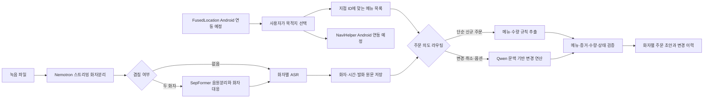

# 모아오더 — 직접 녹음하는 주문 정리 데모

**지도에서 목적지 선택 → 메뉴 확인 → 휴대폰 마이크 녹음 → 녹음 종료 → 화자별 발화와 최종 주문 확인**을 위한 웹 데모가 구현되어 있다. 사용자가 직접 녹음한 음성을 처리하며, 기존 CSV나 예제 음성은 데모 입력으로 사용하지 않는다. 메뉴 변경·추가·취소를 반영한 주문 초안, 발화 시각, 변경 이력, 원음 재생, JSON 다운로드를 제공한다.

음성/LLM 추론은 GPU PC에서 실행한다. 휴대폰 연결에 HTTPS 터널을 사용하면 음성·목적지·메뉴·결과는 터널 제공자를 경유한다. 지도 타일과 외부 길 안내는 외부 지도 서비스에 접속한다. Pleos Android 앱과 FusedLocation/NaviHelper SDK의 실제 연동은 다음 단계다.

## 직접 녹음 데모

```bash
cd /home/ssonniee/Public/Nemotron/drive-order
bash demo.sh
```

서버가 출력하는 접속 키 포함 전체 링크를 GPU PC의 Chrome 또는 Edge에서 연다. 마이크 권한을 허용하고 녹음한다. 처음에는 20~30초 대화에서 한 번 메뉴를 변경한 뒤 결과와 원음을 비교하면 된다. **휴대폰에서는 localhost 링크를 사용할 수 없으며 HTTPS 주소가 필요하다.** 휴대폰 공개 연결은 외부 터널 사용 동의 후 준비한다. [데모 사용법과 저장 위치](demo/README.md)를 참고한다.

웹 데모는 녹음 조각을 수시로 저장하고 **녹음을 마친 뒤** 분석한다. 화면을 켠 상태에서 최대 60분까지 녹음할 수 있도록 구성했으며, 60분 실기기 녹음 검증은 아직 하지 않았다. 모델은 휴대폰에 올라가지 않는다.

등록 매장 카드나 지도 마커를 누르면 **스타벅스 왕십리역9번출구점 8개 / 맥도날드 한양대 5개 / 백소정 한양대점 5개** 메뉴가 자동으로 불러와진다. 사용자가 제공한 메뉴는 `demo/stores.json`에 있으며 녹음 시작 시 선택한 매장 ID와 메뉴 목록을 함께 저장한다. 현재 지도는 Leaflet/OSM이고 네이버 지도·메뉴 API 연동은 아니다.

## 실행

현재 컴퓨터의 `nemo` 환경과 `diarizen` 환경을 재사용한다. 추가 소형 Python 의존성은 이 폴더의 `.deps`에 설치되어 있다. `run.sh`는 저장소의 NeMo 코드를 먼저 읽는다. 설치된 NeMo만 사용하면 한국어 `target_lang` 전달이 실패하는 차이가 있었다.

```bash
cd /home/ssonniee/Public/Nemotron/drive-order

# 실제 음성 → 화자별 발화 → 최종 주문 초안
bash run.sh audio \
  --input ../Nemotron-ASR/audio/RS0002_05_R04_1104_sound.wav \
  --menu examples/menu.json \
  --trip examples/trip.json \
  --output results/my_first_run

# 음성 모델을 다시 돌리지 않고 LLM 주문 변경만 검증
bash run.sh replay \
  --input examples/order_changes.jsonl \
  --menu examples/menu.json \
  --output results/my_order_replay

# 기존 Nemotron ASR을 사용한 비교 실행
bash run.sh audio \
  --input results/fixtures/overlap_distinct.wav \
  --menu examples/menu.json --asr nemo \
  --output results/my_nemo_comparison

# 비즈니스 로직 검증: 모델 다운로드/추론 없음
/home/ssonniee/anaconda3/envs/nemo/bin/python -m unittest discover -s tests -v
```

출력 폴더는 매번 새 이름을 사용한다. 이미 결과가 있는 폴더는 거부해 서로 다른 여행의 화자와 주문이 섞이지 않게 했다. 재생 입력은 한 여행의 JSONL이며 `start` 순으로 정렬되어 있어야 한다. 서로 다른 녹음의 `speaker_0`은 같은 사람이라는 뜻이 아니다.

다른 환경에서는 `DRIVE_ORDER_PYTHON`과 `--separator-python`으로 Python 경로를 지정한다. 기본 Python에는 `requirements.txt`의 패키지가, 분리용 Python에는 호환되는 `torch`, `torchaudio`, `speechbrain`이 필요하다. 시스템에 `ffmpeg`가 있어야 한다. 기본 모델을 다시 받는 코드는 `scripts/download_models.py`다. 분리 모델은 처음 겹침이 발견될 때 SpeechBrain이 받는다. 현재 실행 버전은 `environment.txt`에 기록했다.

## 처리 구조



| 단계 | 기본 모델/방법 | 선택 이유와 범위 |
|---|---|---|
| 화자분리 | NVIDIA Nemotron-3-Diarization, 약 0.1B | 스트리밍 speaker cache를 녹음 전체에서 유지. 최대 8개 익명 화자 채널 |
| 음원분리 | SpeechBrain SepFormer WSJ0-2Mix, 약 26M | 두 화자가 겹친 구간에만 실행. 주변의 단독 발화 에너지로 출력 채널을 화자에 대응 |
| 한국어 ASR | Whisper large-v3-turbo, 약 0.8B | 비교용 한국어 겹침 실험에서 기존 ASR보다 빠른 실행. Nemotron 0.6B도 `--asr nemo`로 유지 |
| 주문 추출 | 규칙 + Qwen 하이브리드 | 단순 주문은 즉시 처리하고, 변경·취소·옵션만 같은 화자의 장부·최근 발화와 함께 Qwen에 전달. JSON 스키마 생성 + 별도 장부 검증 |
| 상태 저장 | JSON / JSONL / RTTM / NPY | 발화와 주문 결정의 근거를 확인하고 재실행 가능 |

화자분리만으로 겹친 음성이 분리되지는 않는다. 음원분리를 별도 수행하며, 분리 채널 번호를 화자 번호로 간주하지 않는다. 대응 근거가 없거나 상충하면 `needs_review=true`로 저장하고 해당 발화로 주문을 갱신하지 않는다.

분리 모델에는 주변 단독 발화 문맥을 포함해 입력하되, ASR용 음성은 다른 사람이 말하는 부분만 분리 출력으로 교체한다. 단독 발화는 원음을 보존한다. Whisper에는 선택한 지점의 메뉴명(최대 500자)을 어휘 힌트로 전달하며, 최종 LLM에도 같은 메뉴 목록을 제공한다.

GPU에는 단계를 순차적으로 올린다. NeMo와 SpeechBrain의 의존성 차이를 피하기 위해 음원분리만 별도 Python 프로세스에서 실행한다. 4B LLM의 BF16 실행은 약 8 GiB 수준의 GPU 텐서 메모리를 사용했다. **현재는 PC/서버용 검증 구성이며 차량 Android 기기에서 직접 실행 가능하다고 검증한 것은 아니다.** `--int4` 옵션은 별도 bitsandbytes/accelerate 설치가 필요한 미검증 배포 실험 옵션이다.

## 출력

| 파일 | 내용 |
|---|---|
| `utterances.jsonl` | 발화 ID, 화자, 시작/종료 초, 원문, 겹침/검토 여부, ASR 종류 |
| `speakers/speaker_*.jsonl` | 화자별 발화 기록 |
| `diarization.json`, `diarization.rttm` | 화자 발화 구간 |
| `speaker_probs.npy` | 10 ms 간격 화자 활동 확률; 디스크 기반 저장 |
| `clips/`, `clips.json` | ASR에 실제 사용한 음성과 대응 메타데이터 |
| `order_events.jsonl` | 각 발화의 원문, LLM 연산, 적용 전/후 주문, 거부 이유 |
| `orders.json` | 지점별·화자별 최신 주문 초안과 확인 필요 건수 |
| `menu.json`, `trip.json` | 해당 실행에 고정한 메뉴와 목적지 |
| `navigation_request.json` | Android 어댑터가 처리할 길 안내 요청 데이터. 실제 호출 결과 아님 |
| `metrics.json` | 단계별 시간, 모델/백엔드, 음성 길이, 최대 GPU 텐서 메모리 |

`start`/`end`는 **화자 발화 구간 또는 분리된 발화의 범위**이다. 단어 단위 강제 정렬 결과가 아니다. `speech_spans`에는 범위 안의 실제 화자분리 구간을 따로 보존한다. 이름/좌석은 자동으로 알 수 없으며 앱에서 `speaker_0 → 운전자` 같은 사용자 확인 매핑이 필요하다.

## 문맥과 주문 변경

LLM은 주문표를 통째로 덮어쓰지 않고 `set`, `add`, `remove`, `clear` 연산을 반환한다. 코드는 현재 화자의 장부에만 원자적으로 적용한다. 연산 하나라도 잘못되면 해당 발화의 변경 전체를 적용하지 않는다.

* “카레 하나” → 카레 1개 설정
* “카레 말고 짜장면 두 개” → 카레 삭제 + 짜장면 2개 설정
* “제로 콜라 두 잔 추가” → 기존 주문 보존 + 제로 콜라 수량 추가
* “제로 콜라는 취소” → 제로 콜라 삭제
* “만두 얼마예요?” → 주문 변경 없음

전체 대화는 디스크에 보존하고, LLM에는 현재 주문과 최근 8개 기록 중 같은 화자의 발화를 전달한다. 대화 전체를 매번 보내지 않는다. 오래전에 주문한 음식도 장부에는 유지된다. 다만 과거의 임의 대화를 검색하는 기능이나 “옆 사람과 같은 것으로” 같은 화자 간 참조는 아직 지원하지 않는다.

등록되지 않은 메뉴 ID, 발화 근거가 없는 음식, 잘못된 수량, 불확실한 화자 대응은 확인 대상으로 돌린다. 메뉴명/별칭 증거 검사는 보수적이므로 심한 ASR 오인식은 자동 보정하지 못할 수 있다. 옵션은 사용자의 요청을 기록한 것이며 식당의 제공 가능 여부를 보증하지 않는다. 모든 결과는 주문 **초안**이고 실제 주문/결제는 실행하지 않는다.

`--order-backend hybrid`는 평범한 메뉴·수량 발화에는 규칙을 사용하고 `아니다`, `말고`, 변경·취소·옵션 표현에만 LLM을 지연 적재한다. LLM이 이전 메뉴명을 생략한 변경을 해석해도, 기존 주문이 하나이고 새 메뉴가 현재 발화에서 확인되는 경우에만 자동 교체한다. 기존 주문이 여러 개라 대상이 모호하면 장부를 바꾸지 않고 확인 대상으로 남긴다.

화자 대응이 성공해 장부에 반영된 겹침 발화도 `overlap_confirmation_count`에 집계하고 `status=needs_confirmation`으로 저장한다. 분리·전사에서 일부 메뉴가 누락될 가능성이 실제 검증에서 확인되었기 때문이다. 이 상태를 실제 주문 확정으로 취급하면 안 된다.

## Nemotron 3.5 Transcribe 비교 실험

`--speech-backend nemotron35`는 `Nemotron-3-Diarization → SepFormer → Whisper`를 건너뛰고, 전체 16 kHz 녹음을 Nemotron 3.5 Transcribe에 전달한다. 모델이 반환한 화자 태그와 CTC 단어 시각을 기존 `utterances.jsonl` 형식으로 변환하므로 주문 처리/UI는 그대로 사용한다. 기존 경로는 `--speech-backend legacy`로 보존된다.

RTX 5090에서는 BF16이 아니라 NVFP4 체크포인트를 사용한다. 현재 환경은 `vllm download-kernels`로 CUDA 13.0용 FlashInfer 사전 빌드 커널을 설치해 사용한다. ReplaySSM 커널 일부는 첫 실행에 JIT 컴파일되므로, 서버 스크립트는 PyTorch와 동일한 CUDA 13.0 `nvcc`만 사용하도록 검사한다.

```bash
# 1. 큰 체크포인트 다운로드(한 번만 실행)
bash scripts/download_nemotron35.sh

# 2. 별도 터미널에서 OpenAI 호환 Nemotron 서버 실행
bash scripts/start_nemotron35_5090.sh

# 3. 우선 한 샘플에서 음성 단계만 확인
python -m drive_order audio \
  --input /path/to/mixture.wav \
  --menu examples/menu.json \
  --output results/nemotron35_one \
  --speech-backend nemotron35 \
  --nemotron-max-speakers 2 \
  --skip-orders

# 4. 선별한 15개 2화자 샘플의 화자 permutation 보정 CER·메뉴 recall·RTF 측정
python scripts/evaluate_nemotron35.py \
  --manifest /home/yubin/workspace/Hyundai/aihub_menu_order/manifests/demo_2spk_context_overlap25_15.jsonl \
  --output results/nemotron35_demo15
```

5090 32 GB에서는 비교 실험 중 Nemotron 서버가 GPU 대부분을 사용하므로 처음에는 반드시 `--skip-orders`로 음성 성능만 측정한다. 전체 주문 처리는 Nemotron 서버를 종료한 뒤 `replay`로 Qwen을 실행하거나, 두 모델이 동시에 적재되도록 별도 양자화/메모리 프로파일을 검증해야 한다. 서버 스크립트의 8,192 토큰·동시 요청 1개·최대 120초 설정은 짧은 공모전 데모용 시작값이며 장시간 녹음용 검증값이 아니다.

## 목적지 메뉴

`examples/menu.json`은 CSV 발화 검증용 가상 식당의 메뉴다. 실제 식당의 메뉴로 사용하면 안 된다. CSV의 `menu_spans`는 여러 식당·여러 사람의 예시이므로 이를 한 매장의 실제 메뉴로 간주하지 않았다.

실서비스에서는 선택된 지점의 `store_id`, 메뉴 버전, 출처와 업데이트 시간을 관리한다. 매장 제공 데이터 또는 직접 관리한 JSON을 넣을 수 있다. FusedLocation/NaviHelper가 메뉴 목록을 준다고 가정하지 않는다. `trip.destination.store_id`와 `menu.store_id`가 다르면 실행을 거부한다. 목적지 변경은 새 세션 또는 명시적인 주문 재확인 과정으로 처리해야 하며 기존 주문을 새 매장 메뉴에 자동 변환하면 안 된다.

## 긴 녹음과 한계

화자분리는 파일에서 필요한 프레임만 읽고 cache를 이어간다. 전체 음성 텐서를 GPU에 올리지 않는다. ASR/분리는 최대 20초 단위이며 `--max-seconds`는 2–30초 범위다. 모델 메모리는 녹음 길이와 독립적으로 제한되지만 화자 확률, 구간 목록, 저장 파일 크기는 녹음 길이에 비례한다. 경계에서 잘린 긴 연속 발화는 확인 대상으로 남긴다.

92초 반복 음성은 긴 파일 처리의 스모크 테스트다. 수시간의 실제 대화, 화자 재등장, 차량 주행 소음에 대한 정확도 검증을 대신하지 않는다. 이 CLI는 파일을 받아 단계별로 처리하며, 마이크에서 들어오는 데이터를 즉시 앱에 출력하는 완성된 실시간 서비스는 아니다.

동시 발화 분리는 두 사람까지다. 세 명 이상이 같은 분석 구간에서 겹치거나 화자 대응 근거가 부족하면 확인 대상으로 남긴다. 영어 데이터로 학습한 분리 모델의 한국어·차량 환경 성능은 별도 검증이 필요하다. 작은 모델 비교에서도 겹침 구간의 메뉴명이 누락되는 사례가 실제로 관찰되었다. LLM은 사라진 음성 내용을 복원하는 장치가 아니다. `review_count=0`도 전사의 정확도를 보증하지 않는다.

## 공모전과 앱 연결

2026-11-11에 확인한 공식 안내에 따르면 1차는 기획서로 지원할 수 있고, 2차 PT 전에는 동작 가능한 앱이 필요하다. 따라서 이 파이프라인은 검증용 산출물이며 APK 제출물을 대체하지 않는다. Android API 28 이상, Gradle 8.0 이상, Java/Kotlin 요구를 앱 단계에 반영한다. [참가 FAQ](https://appdevchallenge.auto-hmg.io/faq), [개발 환경](https://appdevchallenge.auto-hmg.io/guide/development)

실제 SDK 수명주기와 앱 연결 계약은 `android-contract/README.md`에 정리했다. 앱 단계에서는 위치·목적지·녹음 UI를 Kotlin으로 만들고, 이 엔진을 로컬 테스트 서버 또는 별도 추론 서버로 연결하는 구성이 현실적이다. 녹음 시작/중지와 상태 표시, 도착 시 주문 초안 확인 흐름이 필요하다.

모델 근거: [Nemotron Diarization](https://huggingface.co/nvidia/Nemotron-3-Diarization), [Nemotron ASR](https://huggingface.co/nvidia/nemotron-3.5-asr-streaming-0.6b), [SepFormer](https://huggingface.co/speechbrain/sepformer-wsj02mix), [Whisper Turbo](https://huggingface.co/openai/whisper-large-v3-turbo), [Qwen3 4B](https://huggingface.co/Qwen/Qwen3-4B-Instruct-2507). 비교용 ConvTasNet 소스는 torchaudio v2.6.0에서 가져왔고 `drive_order/vendor/TORCHAUDIO_LICENSE`를 함께 보존했다.

## 실제 검증 결과 읽기

최종 실행은 `results/final_text`, `results/final_long`, `results/final_overlap`이다. `results/validation.json`에서 실행 성공과 정확도 통과를 구분한다. `scripts/evaluate_results.py --require-overlap`은 겹침의 전체 주문 복원이 실패하면 종료 코드 1을 반환한다. 실행이 정상 종료했다고 정확도 검증도 통과한 것으로 처리하지 않는다.

검증 상세와 남은 작업은 `VALIDATION.md`에 정리했다.
