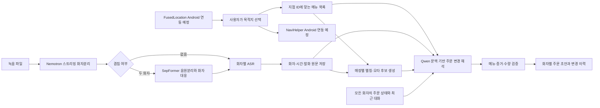

# 모아오더 · MoaOrder

**함께 가는 길, 주문은 하나로.**

목적지로 이동하며 나눈 대화에서 **누가 무엇을 주문할지** 정리하는 음성 기반 주문 도우미입니다. 선택한 매장의 메뉴를 참고해 화자별 발화를 기록하고, 메뉴 추가·변경·취소를 반영하여 주문서를 작성합니다.

**[웹 데모 체험하기](https://udder-purify-retract.ngrok-free.dev/)** · [시연 영상 보기](https://youtu.be/Sa-5V4HNdrk) · [사용 안내](demo/README.md)

> 웹 데모는 서버가 실행 중일 때 이용할 수 있습니다. 접속 키를 요청하면 운영자가 공유한 접속 링크를 이용해 주세요. 이 저장소는 운영 웹의 Qwen 문맥 해석·별칭·오타 보조 처리 구성을 포함합니다. 웹 화면과 운영 기능은 배포 버전에 따라 다를 수 있습니다.

## 이렇게 사용합니다

1. **목적지 선택** — 방문할 매장을 고르고 메뉴를 확인합니다.
2. **주문 대화 녹음** — 함께 이동하는 사람들이 원하는 메뉴를 말합니다.
3. **녹음 종료 후 분석** — 화자별 발화와 메뉴 선택을 정리합니다.
4. **최종 주문 확인** — 사람별 메뉴·수량, 대화 원문, 변경 이력을 확인합니다.

예를 들어 “카레 하나 주세요” 다음에 “카레 말고 짜장면 두 개로 바꿀게요”라고 말하면, 해당 화자의 주문을 **짜장면 2개**로 갱신합니다. 결과와 원음은 다시 확인하고 내려받을 수 있습니다.

## 처리 구조

목적지·메뉴 선택부터 화자별 주문 정리까지의 처리 흐름입니다. FusedLocation과 NaviHelper의 Android 연동은 예정 단계입니다.

| 단계 | 기본 모델 | 역할 |
|---|---|---|
| 화자분리 | Nemotron-3-Diarization | 화자별 발화 시간 구분 |
| 음원분리 | SepFormer WSJ0-2Mix | 두 화자가 겹친 음성 분리 및 화자 대응 |
| 음성 인식 | Whisper large-v3-turbo | 한국어 발화를 텍스트로 변환 |
| 주문 해석 | Qwen3-4B-Instruct-2507 | 메뉴·수량·옵션 및 주문 변경 해석 |

음원분리를 수행한 분석 구간에서는 **화자별 분리 트랙 전체**를 사용하고, 겹침 없는 구간은 원음을 사용합니다. Qwen에는 매장 메뉴, 모든 화자의 주문 상태, 최근 유효 발화 최대 64개를 전달합니다. 다른 사람의 주문을 참고하더라도 현재 말한 사람의 주문만 갱신합니다.

별칭·오타 처리는 **ASR 이후, Qwen 해석 전에 추가하는 보조 단계**입니다. 해당 매장에 메뉴가 있을 때 `아아 → 아이스 아메리카노`, `아샷추 → 아이스티 샷 추가`, `감튀 → 감자튀김`을 연결하고, 유사한 메뉴를 오타 후보로 제공합니다. 매장별 별칭은 메뉴의 `aliases`로 추가할 수 있습니다. ASR 원문은 유지합니다.

현재 발화에 메뉴명이 반드시 있어야 한다는 검사는 적용하지 않습니다. 메뉴 ID·수량·근거 발화 ID를 검증하지만, 이것만으로 해석의 정확성을 보장하지는 않습니다. 모호한 취소나 판매하지 않는 메뉴의 잘못된 대체는 여전히 발생할 수 있어 최종 주문 확인이 필요합니다.

## 확인한 성능

실제 녹음 10개를 동일한 음성 처리 결과로 비교했을 때, 기존 문맥 검증과 별칭·오타 보조 방식 모두 **화자별 최종 주문 13/20명**, **주문 항목 F1 66.7%**였습니다. 주문 해석 시간은 10개 합계 각각 22.55초와 22.69초로 비슷했습니다. 별칭·오타 보조의 일관된 정확도 향상은 아직 확인되지 않았습니다. [평가 조건과 한계](docs/ORDER_EVALUATION.md)를 참고하세요.

## 구현 범위

- **웹**: 목적지·메뉴 선택, 마이크 녹음, 분석 결과·원음 확인, JSON 다운로드
- **서버**: 화자분리 → 음원분리 → ASR → 주문 해석을 순차 실행
- **앱 확장**: iOS 프로젝트와 Android 연동 계약 포함. Pleos SDK 실제 연동은 후속 단계

분석은 PC/GPU 서버에서 수행하며 녹음 종료 후 결과를 제공합니다. 두 사람의 동시 발화를 분리하고, 화자나 발화가 불확실하면 확인 대상으로 남깁니다. 결과는 주문 초안이며 실제 주문·결제는 실행하지 않습니다.

## 개발자 안내

[로컬 실행과 모델 준비](docs/SETUP.md)에서 환경을 구성한 뒤 실행할 수 있습니다. 모델 가중치와 녹음 결과는 저장소에 포함되지 않습니다.

| 경로 | 내용 |
|---|---|
| [drive_order/](drive_order/) | 음성 처리와 주문 정리 파이프라인 |
| [demo/](demo/) | 웹 화면, 서버 운영 안내, 매장 메뉴 |
| [examples/](examples/) | 메뉴·목적지·대화 입력 예시 |
| [scripts/](scripts/) · [tests/](tests/) | 모델 준비, 평가, 기능 검증 |
| [VALIDATION.md](VALIDATION.md) | 기준 구현의 검증 기록과 한계 |
| [ios/](ios/) · [android-contract/](android-contract/) | 앱 소스와 차량 SDK 연동 설계 |

실행 성공과 주문 정확도는 구분해 확인합니다. 실제 차량 소음, 장시간 자연 대화, 세 명 이상 동시 발화에 대한 검증은 추가로 필요합니다.
